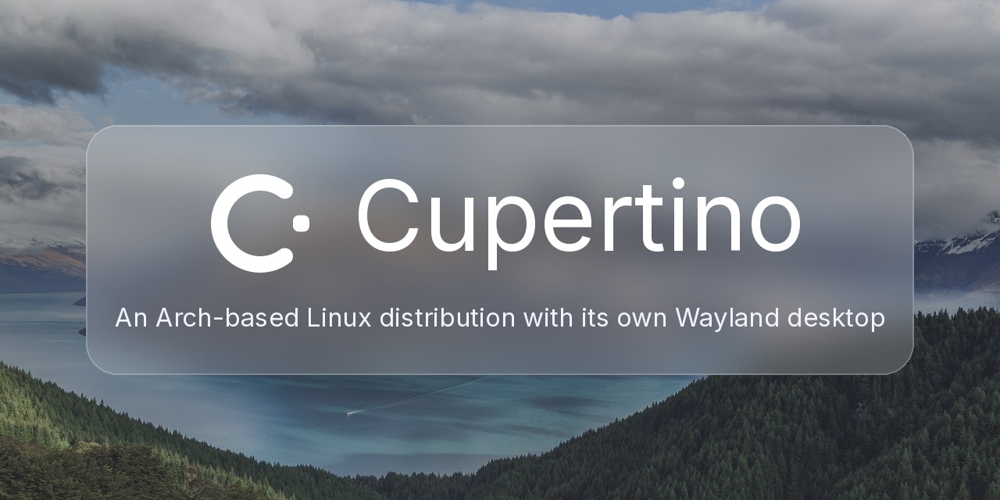

<p align="center">
  
</p>

<p align="center">
  <a href="https://github.com/orafaelfragoso/cupertino/actions/workflows/ci.yml"></a>
  <a href="LICENSE"></a>
  <a href="https://orafaelfragoso.github.io/cupertino/"></a>
  
  
</p>

<p align="center">
  <a href="https://orafaelfragoso.github.io/cupertino/"><strong>Documentation</strong></a> ·
  <a href="docs/src/install-usb.md"><strong>Install from a USB stick</strong></a> ·
  <a href="#try-it-in-one-minute"><strong>Try it</strong></a> ·
  <a href="CHANGELOG.md"><strong>Changelog</strong></a> ·
  <a href="CONTRIBUTING.md"><strong>Contributing</strong></a>
</p>

# Cupertino

Cupertino is an Arch-based Linux distribution with its own Wayland desktop, written in Rust on [Smithay](https://github.com/Smithay/smithay): it installs from a USB stick, and its updates are signed packages that can be rolled back. It gives you a quiet, consistent desktop: translucent materials, soft shadows, spring animations, a dock, a menu bar, a launcher, notifications, a control panel, a file manager, a settings app, a lock screen and a session manager.

**Status: early release (0.x).** It runs nested inside another Wayland session and on a TTY. The TTY backend has run in a virtual machine, not yet on real hardware; treat it as experimental. Interfaces and configuration files can still change between releases. The [changelog](CHANGELOG.md) lists what changed in the current candidate.

## Status

Work is grouped in seven phases. Assessed on 2026-11-04 against merged commit `0a928c70`, phase 4 updated on 2026-11-07:

| Phase | State |
|---|---|
| 1. Baseline and trust | Done |
| 2. Transport and scene | Done |
| 3. CupertinoKit core | Done |
| 4. Apps and portals | In progress: every Cupertino app and shell process draws with Kit, and five portal interfaces exist; installed-session and hardware checks remain |
| 5. Command line, diagnostics, SDK | Started: the `cupertino` command with one subcommand, `cupertino-diagnose`, a first C interface |
| 6. Hardware and distribution | In progress: ISO, installer, signed packages and rollback exist; hardware acceptance and transactional updates remain open |
| 7. AI and voice | Not started |

The live ISO and TTY backend have VM evidence. The full hardware matrix and installed-system acceptance remain open. The [book](docs/src/roadmap.md) has the roadmap, and [Install from a USB stick](docs/src/install-usb.md) the steps.

Cupertino serves Wayland clients. X11 programs run through [`xwayland-satellite`](https://github.com/Supreeeme/xwayland-satellite) when it is installed, started at the first X11 program. The live image ships it with Xwayland; the `cupertino` package lists both as optional (`sudo pacman -S xwayland-satellite xorg-xwayland`); without `xwayland-satellite`, X11 programs stay off.

## Try it in one minute

Run it as a window inside your current Wayland session:

```bash
git clone https://github.com/orafaelfragoso/cupertino.git
cd cupertino
cargo run --release -p cupertino-server -- --winit --spawn foot
```

You need a current stable Rust toolchain, OpenGL ES drivers (Mesa) and a terminal such as `foot`. Other terminals work: `Super+Return` starts the first one it finds among `foot`, `alacritty`, `kitty`, `wezterm` and `xterm`. `Ctrl+Alt+Backspace` quits. See [Building and running](docs/src/building.md) for the TTY session and the other options.

Or start the full desktop on a text console (`Ctrl+Alt+F3`) with `./run-cupertino.sh`. It builds the release binaries, starts the compositor and the shell processes with a fresh session bus, and writes `~/cupertino-tty.log`; it installs nothing and enables no service. `Ctrl+Alt+Backspace` quits and `Ctrl+Alt+F<n>` returns to the console you came from. The TTY backend has run in a virtual machine, not yet on real hardware.

Known problems and how to report them: [Trying Cupertino](docs/src/trying.md).

## Keys

| Keys | Action |
|---|---|
| `Super+Space` | launcher |
| `Super+Tab`, `Super+Shift+Tab` | application switcher (release `Super` to pick) |
| `Super+Return` | terminal |
| `Ctrl+Up`, `F3`, the overview key | overview (the same key closes it) |
| `Ctrl+Left`, `Ctrl+Right`, `Ctrl+1` to `Ctrl+9` | workspaces |
| `Super+Q`, `Super+W`, `Super+M`, `Super+H` | quit application, close window, minimize, hide application |
| `Super+Ctrl+F`, `Super+Ctrl+Left`, `Super+Ctrl+Right` | full screen, tile left, tile right |
| `Super+Shift+3`, `Super+Shift+4`, `Super+Shift+5` | screenshot of the screen, of a selection, toolbar |
| `Super+Ctrl+Q` | lock |

Shortcuts and everything else are configured in plain files under `~/.config/cupertino/`. The server's README lists every file and key.

## What is in the box

Cupertino is a set of small processes around one compositor. A crash in a shell process does not take the desktop down; the compositor restarts it.

| Process | Role |
|---|---|
| `cupertino-server` | compositing, window policy, input, materials, supervision of the shell |
| `cupertino-dock` | dock, application switcher, overview, app grid, workspaces, hot corners |
| `cupertino-menubar` | menu bar, status items, application menus |
| `cupertino-launcher` | search and launch panel |
| `cupertino-notifications` | banners, notification list, `org.freedesktop.Notifications` |
| `cupertino-controlcenter`, `cupertino-osd` | control panel, volume and brightness overlays |
| `cupertino-files`, `cupertino-settings`, `cupertino-screenshot` | file manager, settings app, screenshot tool |
| `cupertino-login`, `cupertino-sessiond` | lock screen and greeter, root-owned session manager |
| `cupertino-netd`, `cupertino-btd`, `cupertino-powerd` | network, Bluetooth and power daemons |

The crates are layered (`foundation`, `models`, `platform`, `render`, `core`, `shell`, `services`, `apps`, `tools`). Model crates are pure logic and are tested without a display. `cargo run -p cupertino-layers` checks that a crate only depends on layers below it. The design is described in [Architecture](docs/src/architecture.md); each crate has its own README.

## Asset packs

Fonts, icons, cursors and wallpapers are not hard-coded. The shell loads them from an **asset pack**: a directory (`CUPERTINO_ASSET_DIR`) with a manifest, and falls back to the default pack for anything the pack does not provide. You can swap the whole look, or one part of it, without rebuilding.

The default pack uses the Inter font, Cupertino's built-in cursors, the icon theme of the host system through the freedesktop icon specification, and wallpapers picked for this project. The pack format and the steps to build your own are in [Asset packs](docs/src/asset-packs.md). Packs are data: they are never part of the source tree.

## Licence

Cupertino is licensed under the [GNU General Public License, version 3 or (at your option) any later version](LICENSE) (`GPL-3.0-or-later`), except the library crates under the [Mozilla Public License 2.0](https://www.mozilla.org/en-US/MPL/2.0/) (`MPL-2.0`): `cupertino-wayland-client` and the crates it and the toolkit libraries depend on, each with its own `LICENSE`. An MPL-2.0 crate may not depend on a GPL crate; `cargo run -p cupertino-layers` checks it. Contributions are accepted under a contributor licence agreement; see [CONTRIBUTING.md](CONTRIBUTING.md).

Cupertino is an independent project. It is not affiliated with or endorsed by any operating system vendor.

## Contributing

Read [CONTRIBUTING.md](CONTRIBUTING.md) first. Report security problems as described in [SECURITY.md](SECURITY.md). Everyone taking part follows the [Code of Conduct](CODE_OF_CONDUCT.md).
