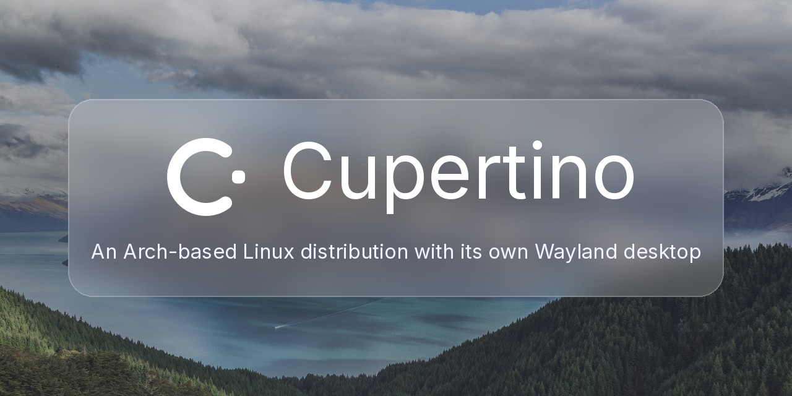
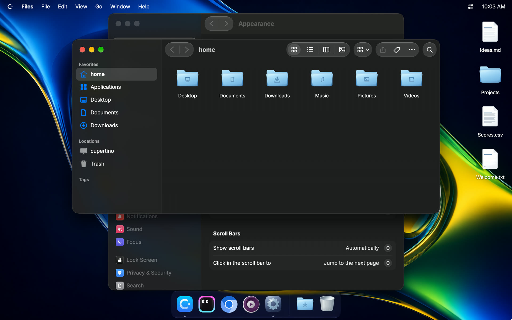
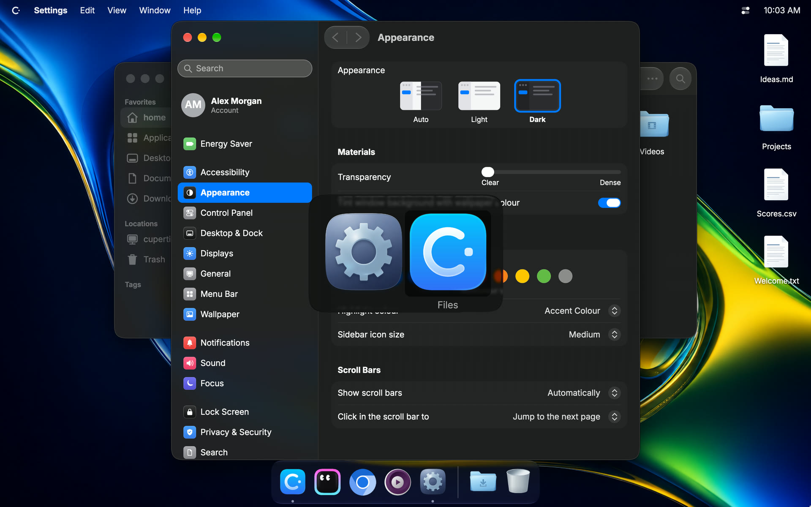
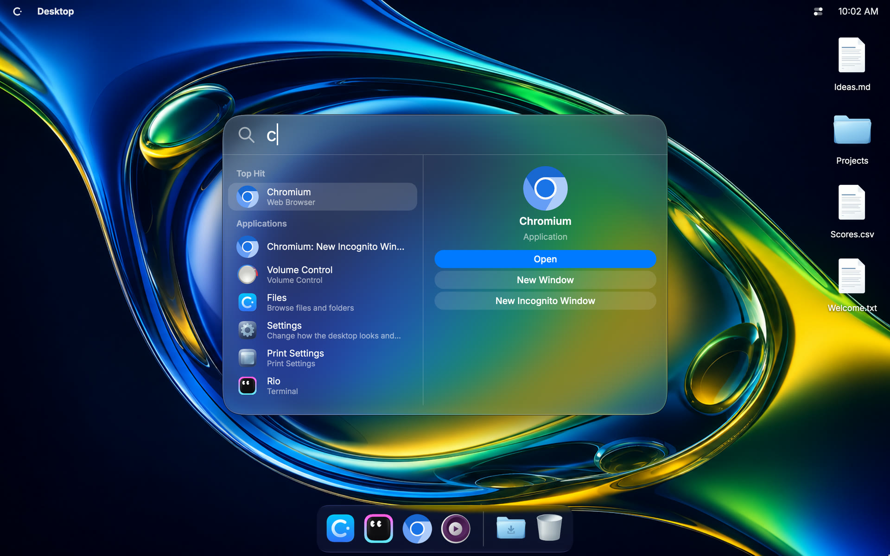
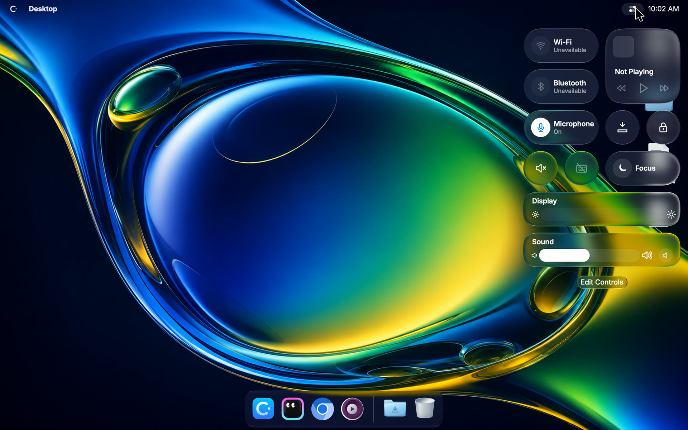

<p align="center">
  
</p>

<p align="center">
  <a href="https://github.com/orafaelfragoso/cupertino/actions/workflows/ci.yml"></a>
  <a href="LICENSE"></a>
  <a href="https://orafaelfragoso.github.io/cupertino/"></a>
  
  
</p>

<p align="center">
  <a href="https://orafaelfragoso.github.io/cupertino/"><strong>Documentation</strong></a> ·
  <a href="#try-it-in-one-minute"><strong>Try it</strong></a> ·
  <a href="docs/src/install-usb.md"><strong>Install</strong></a> ·
  <a href="CHANGELOG.md"><strong>Changelog</strong></a> ·
  <a href="CONTRIBUTING.md"><strong>Contributing</strong></a>
</p>

# Cupertino

Cupertino is a Linux desktop built from scratch: a Wayland compositor, a shell, a UI toolkit and a set of apps, all written in Rust, shipped as an Arch-based distribution that installs from a USB stick and updates through signed packages you can roll back.

It aims for a desktop that feels finished: translucent materials, soft shadows, spring animations and one consistent look across the dock, menu bar, launcher, notifications, control panel, file manager, settings, lock screen and login screen.

<table>
  <tr>
    <td width="50%"></td>
    <td width="50%"></td>
  </tr>
  <tr>
    <td align="center">Desktop</td>
    <td align="center">Application switcher</td>
  </tr>
  <tr>
    <td width="50%"></td>
    <td width="50%"></td>
  </tr>
  <tr>
    <td align="center">Launcher</td>
    <td align="center">Control panel</td>
  </tr>
</table>

## Highlights

- **A whole desktop, one codebase.** Compositor, shell, toolkit, apps, login and session manager, system daemons, installer and packaging live in one Rust workspace and share one design.
- **Materials on the GPU.** The compositor draws backdrop blur and glass with OpenGL ES. Apps built with the toolkit, CupertinoKit, draw on the GPU too, with a CPU renderer that they are tested against and fall back to.
- **Crash isolation.** The dock, menu bar, launcher and the other shell parts are separate processes. If one crashes, the compositor restarts it and your windows stay put.
- **Updates you can undo.** Releases are signed pacman packages, and pacman puts an earlier release back from its cache ([Signed updates](docs/src/updates-and-rollback.md)).
- **Runs your apps.** Cupertino serves Wayland clients natively, runs X11 programs through [`xwayland-satellite`](https://github.com/Supreeeme/xwayland-satellite), shows the menus of Electron apps in the menu bar and provides an xdg-desktop-portal backend for file choosers, screen sharing and screenshots.
- **Swappable look.** Fonts, icons, cursors and wallpapers come from asset packs you can replace without rebuilding ([Asset packs](docs/src/asset-packs.md)).
- **Made for agents, with consent.** `cupertino-control` lets local AI agents see and operate the desktop through an MCP server. Each app is asked once and can be turned off at any moment in Settings › Privacy.
- **Tested.** More than 8,000 tests, headless screenshot tests of the whole desktop, and a layering check that keeps every crate depending only on the layers below it.

## Status

Cupertino is an early release (0.x). It runs on real hardware and is in daily use on desktop machines with NVIDIA GPUs, using both the GPU and the CPU renderers. It also runs nested as a window inside another Wayland session and in virtual machines. Interfaces and configuration files can still change between releases.

The [roadmap](docs/src/roadmap.md) tracks what is next, and the [changelog](CHANGELOG.md) lists what changed. Known problems and how to report them are in [Trying Cupertino](docs/src/trying.md).

## Try it in one minute

Run it as a window inside your current Wayland session:

```bash
git clone https://github.com/orafaelfragoso/cupertino.git
cd cupertino
cargo run --release -p cupertino-server -- --winit --spawn rio
```

You need a current stable Rust toolchain, OpenGL ES drivers (Mesa or your GPU vendor's) and a terminal such as [Rio](https://github.com/raphamorim/rio). `Super+Return` opens your terminal: the one `xdg-terminal-exec` or `$TERMINAL` names, else a common one that is installed. `Ctrl+Alt+Backspace` quits.

To run the full desktop from a text console (`Ctrl+Alt+F3`), use `./run-cupertino.sh`. It builds the release binaries, starts the compositor and the shell with a fresh session bus, and writes `~/cupertino-tty.log`. It installs nothing and enables no service. `Ctrl+Alt+F<n>` returns to the console you came from.

See [Building and running](docs/src/building.md) for every option.

## Install

- **From a USB stick:** the live ISO installs Cupertino as a full distribution. See [Install from a USB stick](docs/src/install-usb.md).
- **On an existing Arch Linux system:** `scripts/package-local.sh` builds the `cupertino`, `cupertino-data` and `cupertino-kit` packages of your checkout. Install them with `sudo pacman -U ~/.cache/cupertino-pkg/*.pkg.tar.zst` ([details](docs/src/building.md#installing-a-local-build)).

X11 programs need `xwayland-satellite` and `xorg-xwayland`. The live image ships both, and the `cupertino` package lists them as optional.

## Keys

| Keys | Action |
|---|---|
| `Super+Space` | launcher |
| `Super+Tab`, `Super+Shift+Tab` | application switcher (release `Super` to pick) |
| `Super+Return` | terminal |
| `Ctrl+Up`, `F3`, the overview key | overview (the same key closes it) |
| `Ctrl+Left`, `Ctrl+Right`, `Ctrl+1` to `Ctrl+9` | workspaces |
| `Super+Q`, `Super+W`, `Super+M`, `Super+H` | quit application, close window, minimize, hide application |
| `Super+Ctrl+F`, `Super+Ctrl+Left`, `Super+Ctrl+Right` | full screen, tile left, tile right |
| `Super+Shift+3`, `Super+Shift+4`, `Super+Shift+5` | screenshot of the screen, of a selection, toolbar |
| `Super+Ctrl+Q` | lock |

Shortcuts and everything else are configured in plain files under `~/.config/cupertino/` or in the Settings app. The [server's README](crates/cupertino-server/README.md) lists every file and key.

## Architecture

Cupertino is a set of small processes around one compositor.

| Process | Role |
|---|---|
| `cupertino-server` | compositing, window policy, input, materials, supervision of the shell |
| `cupertino-dock` | dock, application switcher, overview, app grid, workspaces, hot corners |
| `cupertino-menubar` | menu bar, status items, application menus |
| `cupertino-launcher` | search and launch panel |
| `cupertino-notifications` | banners, notification list, `org.freedesktop.Notifications` |
| `cupertino-controlcenter`, `cupertino-osd` | control panel, volume and brightness overlays |
| `cupertino-files`, `cupertino-settings`, `cupertino-screenshot` | file manager and desktop items, settings app, screenshot tool |
| `cupertino-portal` | xdg-desktop-portal backend: file chooser, screen sharing, screenshots, app chooser, appearance |
| `cupertino-polkit-agent`, `cupertino-keyring-prompter` | password prompts for polkit and the keyring |
| `cupertino-control` | desktop control for local agents, with consent per app, and its MCP server |
| `cupertino-login`, `cupertino-sessiond` | login and lock screens, root-owned session manager |
| `cupertino-netd`, `cupertino-btd`, `cupertino-powerd` | network, Bluetooth and power daemons |
| `cupertino` | the command line ([The cupertino command](docs/src/cupertino-command.md)) |

The 94 crates of the workspace are layered (`foundation`, `models`, `platform`, `protocol`, `transport`, `render`, `ui`, `core`, `shell`, `services`, `apps`, `tools`). Model crates are pure logic, tested without a display, and `cargo run -p cupertino-layers` checks that no crate reaches above its layer. [Architecture](docs/src/architecture.md) describes the design.

Apps can be written in Rust with CupertinoKit ([Getting started with Kit](docs/src/kit-getting-started.md)). A C SDK is in progress.

## Working with AI agents

Cupertino is developed with AI coding agents and is built to be operated by them.

- **Desktop control over MCP.** `cupertino-control --mcp` is an MCP server that lets an agent such as Claude Code or Codex read windows and their controls, act on them, move the pointer, type and take screenshots of the session it runs in. The person stays in charge: each app asks once, the answer is remembered, and Settings › Privacy › Desktop Control and Screen Capture can turn it off at once. Authentication prompts and protected panels are never exposed, and `Ctrl+Alt+Escape` ends any run.
- **Agent skills in the repository.** `.agents/skills/` holds skills for reviewing the codebase, writing Rust in the project's style, testing a change inside the running desktop and controlling it.

## Contributing

Contributions are welcome. Read [CONTRIBUTING.md](CONTRIBUTING.md) for how to build, test and what a good change looks like. Report security problems as described in [SECURITY.md](SECURITY.md). Everyone taking part follows the [Code of Conduct](CODE_OF_CONDUCT.md). Questions and ideas go to [Discussions](https://github.com/orafaelfragoso/cupertino/discussions), bugs and feature requests to [Issues](https://github.com/orafaelfragoso/cupertino/issues).

## Licence

Cupertino is licensed under the [GNU General Public License, version 3 or (at your option) any later version](LICENSE) (`GPL-3.0-or-later`), except the library crates under the [Mozilla Public License 2.0](https://www.mozilla.org/en-US/MPL/2.0/) (`MPL-2.0`): `cupertino-wayland-client` and the crates it and the toolkit libraries depend on, each with its own `LICENSE`. An MPL-2.0 crate may not depend on a GPL crate, and `cargo run -p cupertino-layers` checks it. Contributions are accepted under a contributor licence agreement; see [CONTRIBUTING.md](CONTRIBUTING.md).

The default asset pack uses the Inter font, Cupertino's own cursors and its own icons (`data/assets/cupertino`, `GPL-3.0-or-later`). Other packs are data and are not part of the source tree.

Cupertino is an independent project. It is not affiliated with or endorsed by any operating system vendor.

## Acknowledgements

Cupertino stands on [Smithay](https://github.com/Smithay/smithay) for Wayland protocol handling, [Arch Linux](https://archlinux.org) for its base, [`xwayland-satellite`](https://github.com/Supreeeme/xwayland-satellite) for X11 programs and the [Inter](https://rsms.me/inter/) typeface, along with the many crates listed in `Cargo.lock`.
